

# Introduction
A camera response function can be defined as a non-linear mapping from scene exposure values to pixel values. Debevec and Malik method's goal is to recover that response function. If a camera's response function is known, the inverse of it can be used to obtain a radiance map from pixel values. The recovering response function method is implemented in this assignment.

# Method

$$f(X) = Z \rightarrow X = f^{-1}(Z)$$

$$X = E \cdot \Delta t \rightarrow E = f^{-1}(Z) / \Delta t$$

The natural logarithm of both sides is taken and the $g$ function defined as:

$$g(Z_{ij}) = \ln f^{-1}(Z_{ij}) = \ln E_i + \ln \Delta t_j$$

$i$ represents the pixel index and $j$ represents the exposure time index. There is an equation for each pair of pixel and exposure time. Pixel values, $Z_{ij}$, and exposure times, $\Delta t_j$, are known. A linear system is constructed to be optimized to recover g function.

$$\mathcal{O} = \sum_{i=1}^{N} \sum_{j=1}^{P} [g(Z_{ij}) - \ln E_i - \ln \Delta t_j]^2 + \lambda \sum_{z=Z_{min}+1}^{Z_{max}-1} g''(z)^2$$

$N$ is the number of sampled pixels and $P$ is the number of images in the sequence. $\lambda$ is the weight of the smoothness term, $g''(z)^2$ to recover a smooth $g$ function. The method's aim is to recover $g$ and $\ln E_i$. The $g$ function maps pixel values to log exposures. So, 256 values of $g$ are unknown. Also, $\ln E_i$ has N unknown values. So, there is a total of N + 256 unknowns. 
The linear system is solved in the least-squares sense. $Ax = b$ needs to be solved. $x$ has the unknown values. Each data row has two non-zero entries where +1 for the pixel value of $g$ and -1 for that pixel's $\ln E_i$ value and $\ln \Delta t$ for corresponding $b$ row. A fix row is included to have 0 for the middle value, $g(128) = 0$. 254 smoothness rows are in the $A$ matrix. So, there are $N \cdot P$ data equations. The middle value of $g$ is fixed to 0, so there are 255 + N remaining unknowns. Since more equations are needed than unknowns, $N(P-1) > 255$, $N$ should be chosen accordingly.

The paper states that middle values are more trusted than saturated or dark values. Dark pixels are noisy and bright pixels can be clipped.  So a hat function defined as the weight function.  $w(z) = z$ if $z \le 127$, $255 -z$ otherwise. The weight function is applied to both data rows and smoothness rows. 

Solving the linear system in the least-squares sense, the $g$ function is recovered. Then, the $g$ function can be used to obtain radiance maps from images taken by the same camera. In this assignment, the recovering $g$ function part is implemented.

# Implementation
The project consists of data, results and src folders, a main file and an experiment script to call main function with different parameters at once. The program takes an image sequence folder path as a command line argument and recover the response function using the other parameters given on the command line such as sample count, smoothness $\lambda$, a random seed and exposure mode.

There exist an `InputSequence` class that stores all the images of a sequence. `io_utils.py` contains functions for reading images, reading EXIF data and writing statistics rows. Every folder in data folder that contains images is treated as separate sequences. `ReadInputSequence` function loads the images in a given folder path via OpenCV functions and create an `InputSequence` instance from them.

The exposure time of each frame is decided while reading. There are two exposure time modes, 'doubling' and 'exif'. If the mode is 'doubling', exposure time is doubled for each frame as stated in the homework files. If the mode is 'exif', whether the file has EXIF data is checked. If the file contains EXIF data, exposure time is read from there. Otherwise, the program is stopped for that sequence. 

To be able to operate on pixels from all images in the sequence, the images are stacked via `numpy.stack()` function. The stacked image array has the shape (P,H,W,3). By doing so, reading the pixels from a specific location for all images can be handled at once. 

The pixels are sampled by `SamplePixels` function in `sampling.py`. Pixels are sampled randomly using a seed, a command line argument. So, same pixel locations are used for all images when the seed is same. The sample count is checked so that the number of equations are more than the number unknowns stated. The pixels are sampled over stacked image, so the readings are just one line indexing operation. Then, The sampled pixels array has the shape (P,N,3). Since the $g$ functions are obtained per color channel, the sampled pixels are transposed so that it has a shape of (3, N, P). So, `samples[c]` can give the right pixel values for a channel $c$.

The linear system is constructed and solved per color channel by `SolveCurve` function in `debevec.py`. The $A$ and $b$ matrices are filled as described in Methods section via `BuildSystem` function. `np.linalg.lstsq()` function is used to solve the linear system. As a result $g_c$ is obtained per channel $c$. 

The per channel curves are plotted using matplotlib functions. Each plot contains the curves and the parameters $\lambda$, $N$, exposure time mode and image sequence name. The x axis has $\ln X$ values and the y axis has the pixel values.

An experiment runner script is implemented. It traverses the data folder. It runs the program for each image sequence. Different set of parameters are used for each run. Results are saved to image sequence folder under results folder, containing the parameter names. Timings of loading, sampling and solving the system are measured and stored to the CSV file for each experiment. The experiment runner has also command line options to clear result and timing data at the start of experiment.

The experiment runner is called with `python run_experiments.py --clear-stats --clear-results --use_exif ` command. Inside the script, the image sequence folder paths are collected by traversing the data folder. First, 4 different smoothness $\lambda$ values, 1, 10, 50 and 200, are experimented while keeping $N = 100$. Then, 4 different sample pixel count values, 50, 100, 200 and 500, are tried while keeping $\lambda = 50$. Exposure times are read from EXIF data if exist when `--use-exif` is used. Also, the image sequences having EXIF data is experimented with the other exposure mode while keeping $N = 100$ and $\lambda = 50$. For the sRGB sequences, a comparison experiment is done to validate against true sRGB curve. For each of these experiment, a command is created as `python main.py --input-sequence="data/{sequence_name}" --samples={N} --smoothness={lambda} --exposure-mode={'doubling' or 'exif'} --seed=395 --compare-srgb(optional)}` and executed in a subprocess. The experiment runner gets a `--experiments` option select which experiments to run.

# Difficulties

While reading the EXIF data, Pillow function return a rational type or None if there is no EXIF data. When I try to use it, I get some errors. Then, I converted rational type to float, and add a None check. I used doubling exposure times as fallback when there is no EXIF data. Arranging the images to operate on pixels at the same location at the same time was a challenge for me. I prefer to stack the images but the image stack is needed to be transposed to operate on pixels at the same location from all images. While validating the virtual camera srgb data, there was a noticable difference when it is compared to the true sRGB curve. I was suspicious about my technique, then I realized that the method includes a shift amount. After shifting the $g$, the difference make sense.

# Results

As explained in the Implementation section, there are several experiment setups. I chose baseline parameters as $\lambda = 50$ and $N = 100$ for sRGB validation and exposure time mode comparisons. $\lambda$ and $N$ preserves their default values when other $\lambda$ and $N$ parameters are experimented. Lets start with sRGB validation part.

### sRGB validation

The true sRGB curve is generated by inverting the sRGB formula and taking its natural logarithm. Since the method recovers the $g$ up to a scale, the sRGB curve is shifted by the mean difference between $g$ per channel and true sRGB curve. To measure the difference between them, the RMSE is calculated. For srgb image sequence of virtual camera, RMSE is calculated as (0.024, 0.016, 0.061) for (R,G,B) channels. The shift amount is 1.53 for R and G channels, 1.54 for B channel. Pixel values between 5 and 250 is used while measuring since the near 0 or 255 values are not trusted much in the method generally. Since the shift amount for each color channel is close, I plotted the sRGB curve shifted with respect to R channel and write its RMSE to the title. Looking at the RMSE results and the plot, the response function is recovered correctly. B channel has the highest error. I think it is because of there are few bright B samples. 
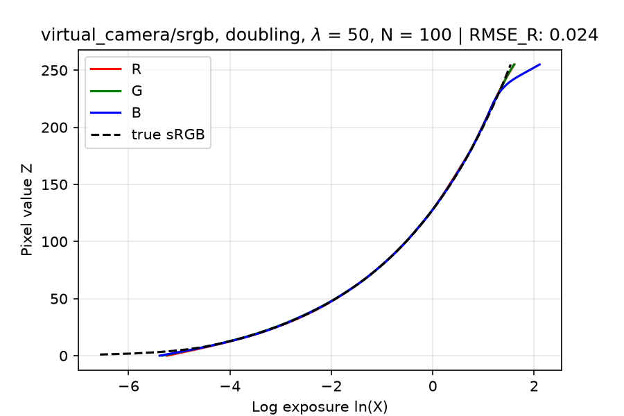

### Noise

The sRGB validation tests are run for several noisy sequences from virtual camera. By looking at the plots of noisy experiments, RMSE grows as noise increases. I assumed that the noisy sequences are sRGB since the RMSE of each one makes sense when compared to the clean sRGB data. The RMSE is 0.024 for clean sRGB data. It is 0.053 for noise25 sequence, 0.072 for noise50 sequence and 0.184 for noise150 sequences. The difference between curves can be seen easily in noise150 plot, which shows how noise affects the camera response curve.

| noise25 | noise50 | noise150 |
|:---:|:---:|:---:|
| 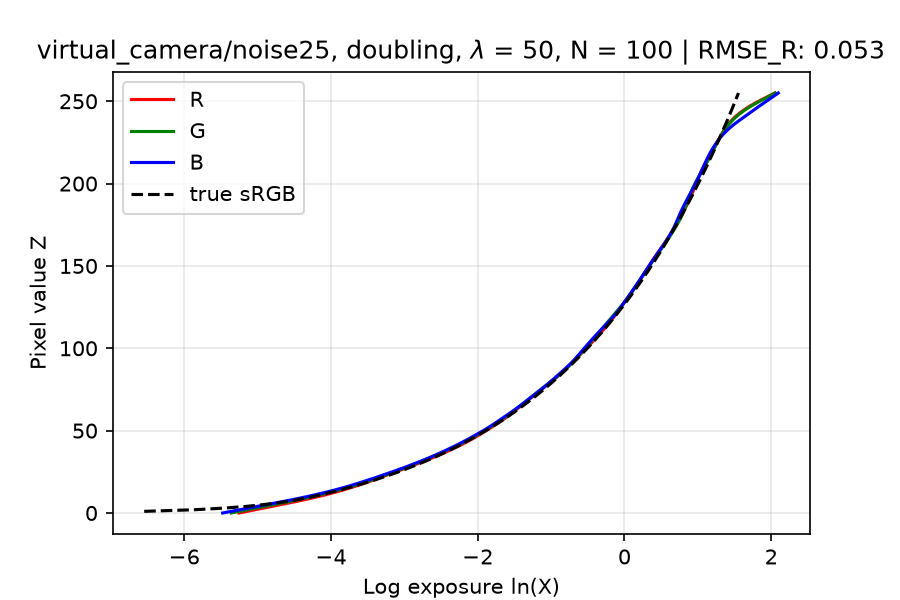 | 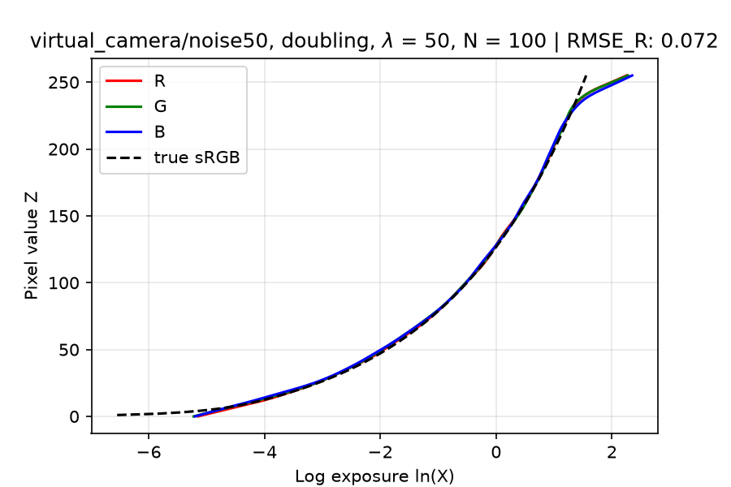 | 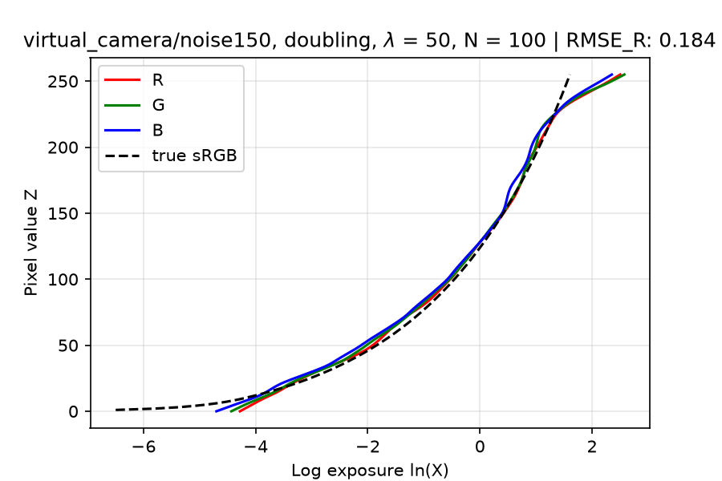 |

By looking at the plot noise150 sequence, as noise increases, higher $\lambda$ is needed. While the curve obtained with $\lambda = 50$ has some wiggles, the curve obtained with $\lambda = 200$ is smoothed well. As the $\lambda$ is larger for the noisy image, the RMSE is decreased to 0.154 from 0.184. So, picking the correct $\lambda$ according to the noise is important to recover the $g$ function correctly. I run the srgb validation with $\lambda = 400$, but the RMSE is decreased only 0.005. So, increasing the $\lambda$ does not give better results all the time.

| noise150, λ = 50 | noise150, λ = 200 |
|:---:|:---:|
|  | 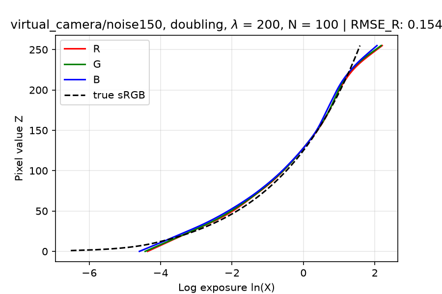 |

### Effect of $\lambda$
The effect of $\lambda$ is tested with values 1, 10, 50, 200 where the number of sample pixels $N$ is 100. The small $\lambda$ causes the curve follows the data, which results in a wiggly curve. The situation is worse when there is noise in the sequence.

| λ = 1 | λ = 50 | λ = 200 |
|:---:|:---:|:---:|
| 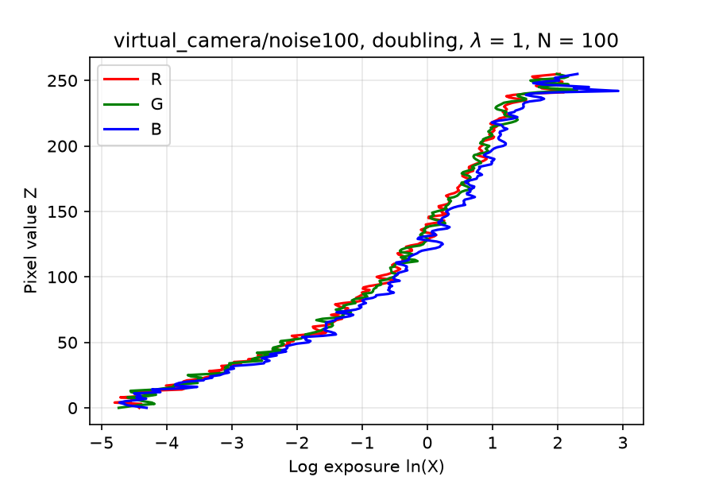 | 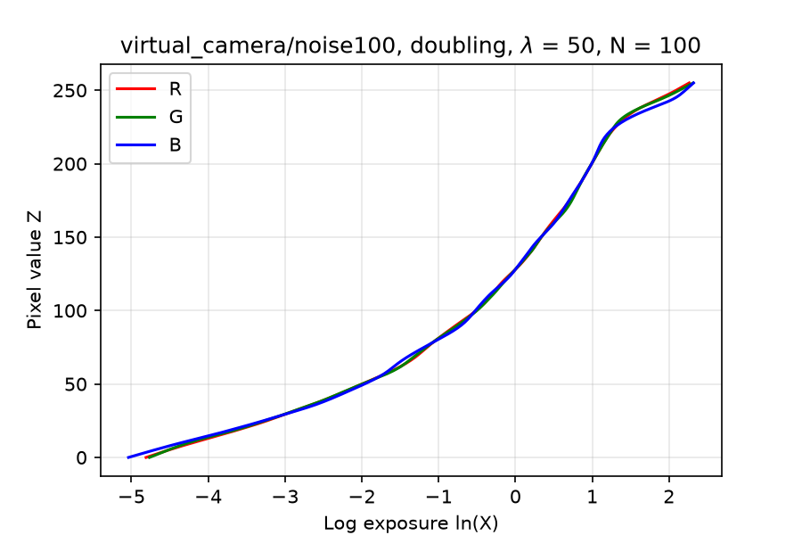 | 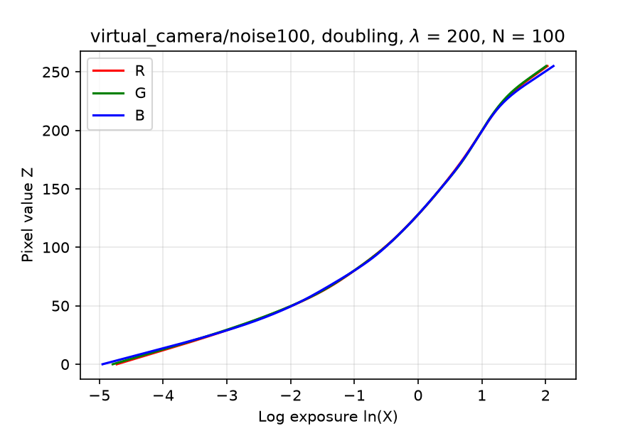 |

Large $\lambda$ produces smoother curves. However, it can flatten the real bends in the curve. We can see it from the sequence taken by Minolta DiIMAGE A1. The shoulder shape for high exposure time values are gone when $\lambda$ is increased to 200 from 10.

| Minolta, λ = 10 | Minolta, λ = 200 |
|:---:|:---:|
| 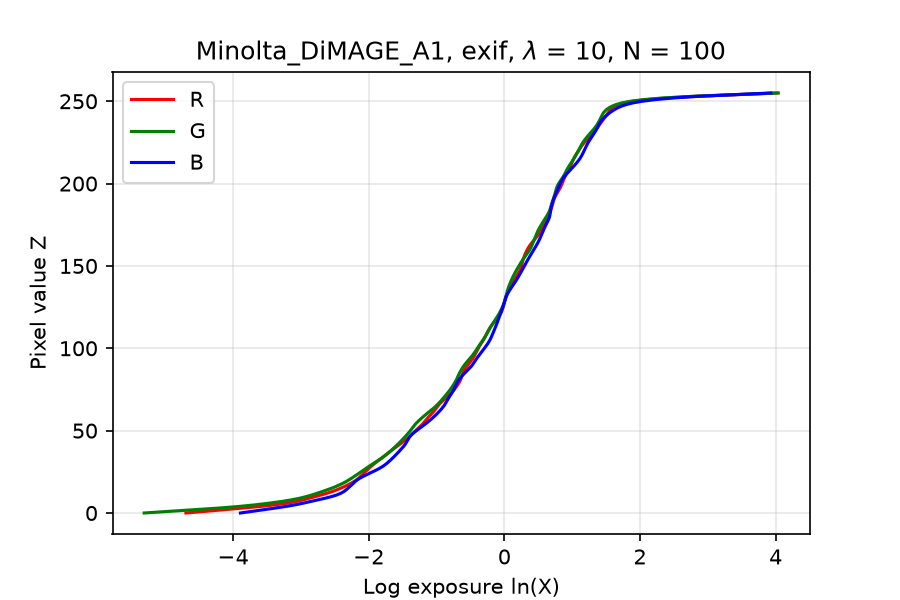 | 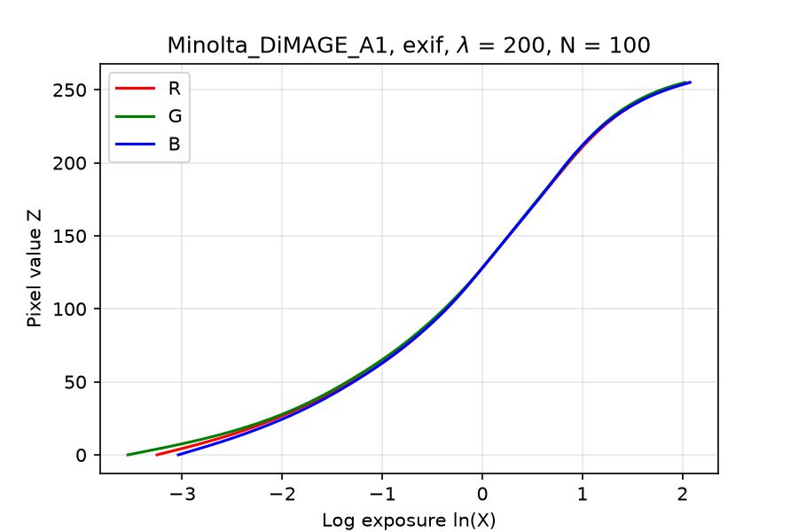 |

The curve obtained with clean srgb data is less affected by $\lambda$ when it is compared with noisy or real camera data. The plots below can be compared with the plots from the noise100 sequence mentioned above.

| λ = 1 | λ = 50 | λ = 200 |
|:---:|:---:|:---:|
| 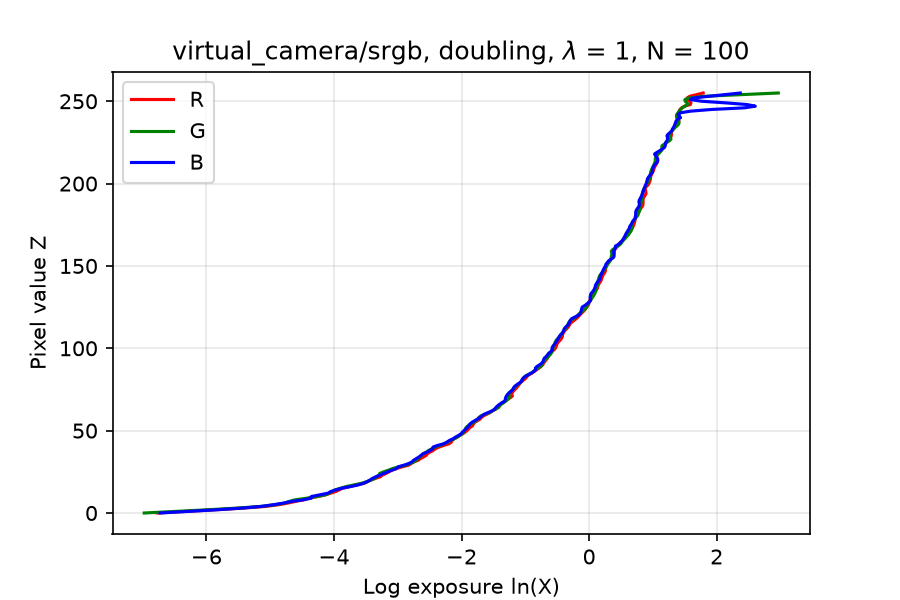 | 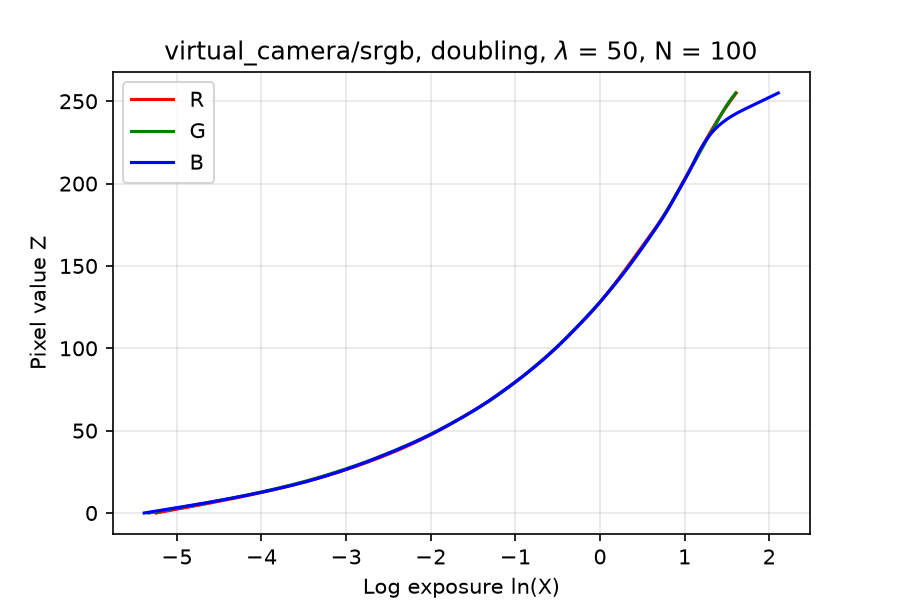 | 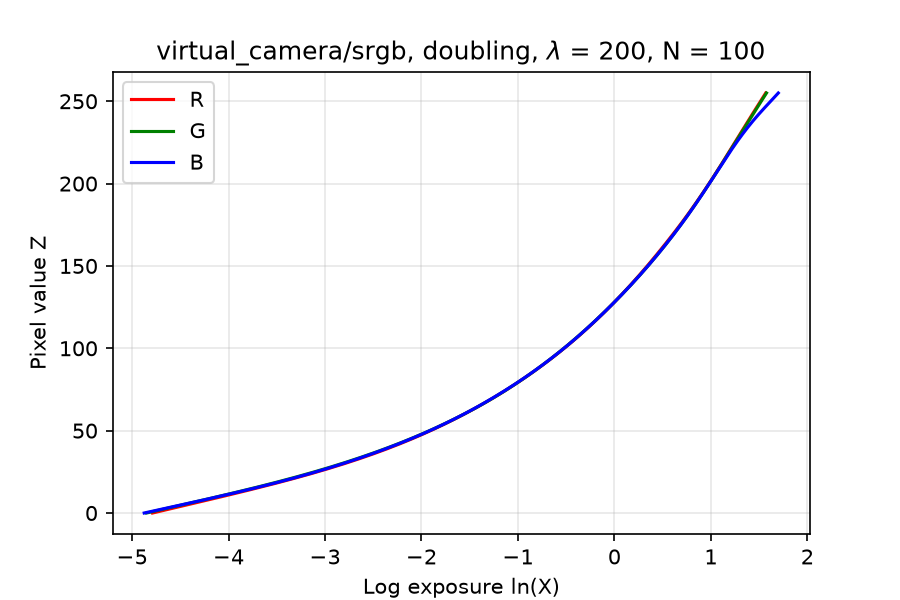 |

### Effect of $N$
The effect of the number of pixels, $N$, is tested with values 50, 100, 200, 500 where $\lambda$ is 50. 
I would expect that more samples should result in better curves. However, I could not achieve that from my experiments. On the clean sRGB data, the RMSE values does not have a clear pattern. The RMSE values are 0.025, 0.024, 0.016, 0.036 as N goes from 50 to 500. 
Increasing number of sample pixels increases the solve time faster than linear growth. The solve time measured on the sequence taken by Canon EOS 550D increases as 0.038, 0.06, 0.15, 0.50 seconds as the $N$ goes 50,100,200,500. 

| noise100, N = 50 | noise100, N = 500 |
|:---:|:---:|
| 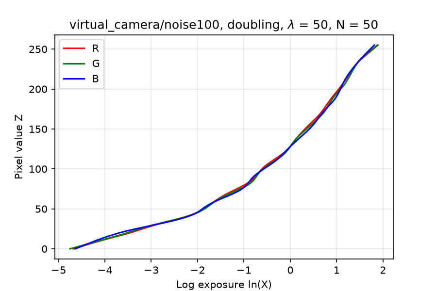 | 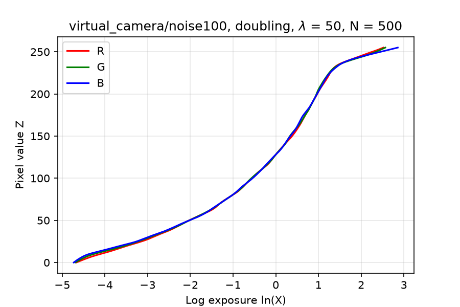 |

### Exposure times
For the sequences taken by Canon, Minolta and Coolpix has x2 steps coming from the EXIF data. So, calculating their exposure times by doubling gives the same results as reading from EXIF data. However, it is not the case for Nikon D2H sequence. I examined the exposure times for this sequence and they alternate. Since, the aperture is also changing in the sequence. So, doubling gives more correct result then using the exposure times from the EXIF data directly.

| Nikon D2H, EXIF | Nikon D2H, doubling |
|:---:|:---:|
| 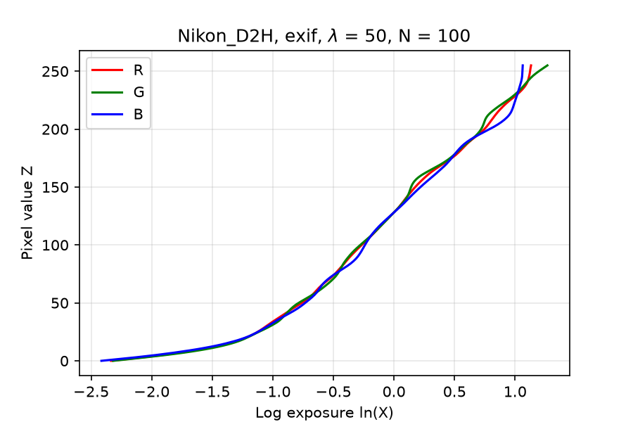 | 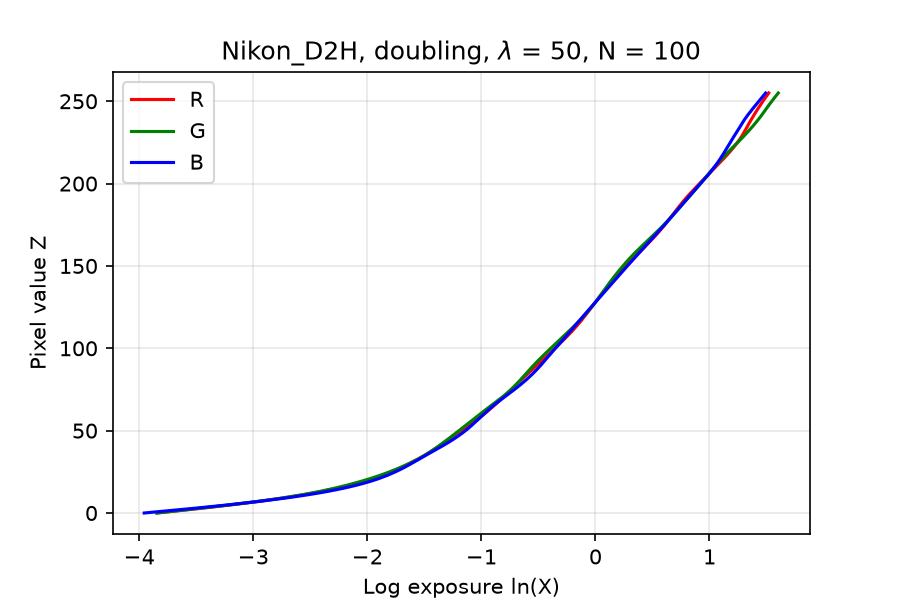 |

### Running times

The total running times including loading the image, sampling pixels and solving the linear system is measured. Total time is affected by the image sizes and sample pixel counts. With my default parameters, the virtual camera sequences takes 0.09 to 0.13 seconds. Sequence taken by my phone, iPhone 17 Pro, takes 0.18 seconds. The other sequences taken by Minolta, Coolpix and D2H takes 0.24 to 0.33 seconds and 0.67 seconds is elapsed for Canon. Loading time depends on image size and takes more time than the other stages. Loading takes 0.58 s of 0.67 s for Canon sequence. Sampling time is nearly constant since it is an indexing operation for each experiment. Solving time depends on the sample count $N$ and the image count $P$, since the equation and unknown counts are depends on $N$ and $P$.

## My phone experiment

I have captured a scene with my phone, iPhone 17 Pro using Adobe Lightromm application. I used the application in manual mode, set ISO to 64 and F number to f/1.8. My sequence consists of 11 JPEG images where shutters are from 1/6400 s to 1/8 s. Image size is 1536x2048.

| Frame 2 (1/1600 s) | Frame 5 (1/200 s) | Frame 8 (1/25 s) |
|:---:|:---:|:---:|
| 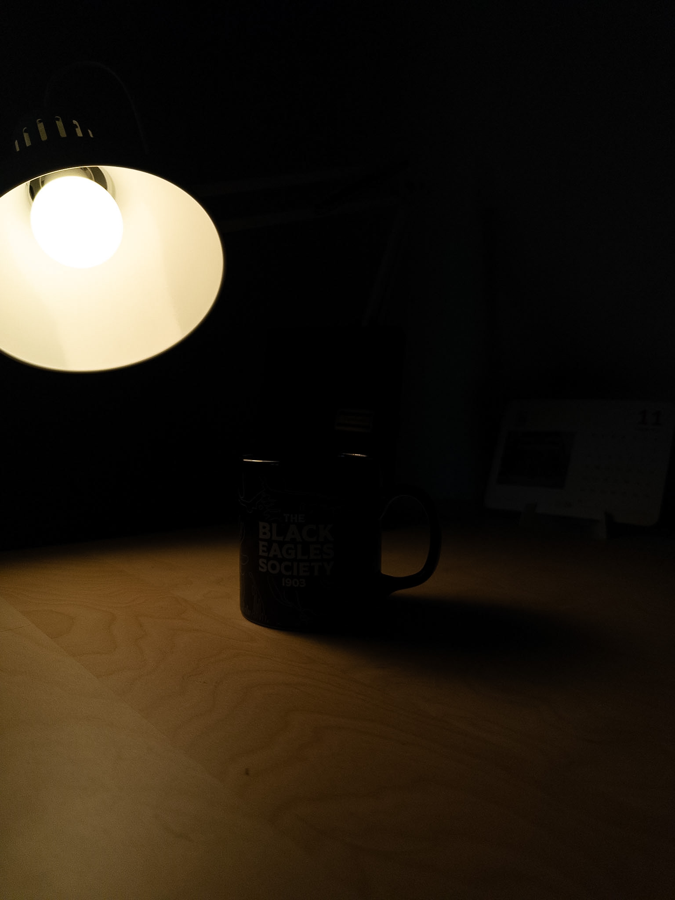 | 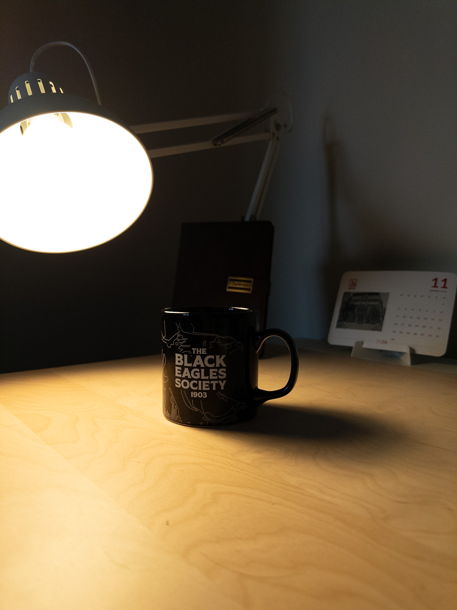 |  |

The first 9 steps are exaclty x2 in the sequence. The last two differs from them with little differences, (1/25 to 1/13) and (1/13 to 1/8)/ So, the using the exposure times from the EXIF data gives better result than just doubling. The response function is an S-curve. It is not the sRGB shape. The RMSE value is 0.513 compared to the true sRGB curve, which is very high compared to the virtual camera results. The curve belongs to the whole pipeline including the processes by the phone and the Lightroom app. It is not the pure sensor's response.

| sRGB comparison (EXIF) | Doubling |
|:---:|:---:|
| 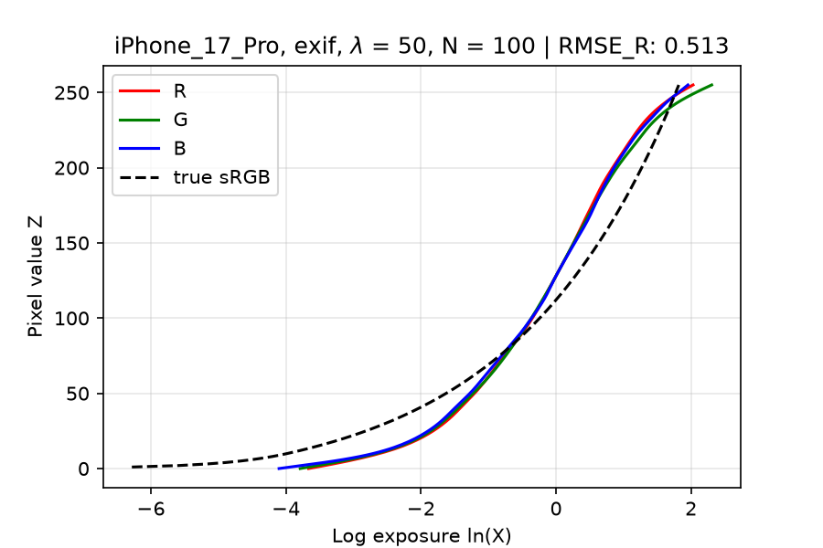 | 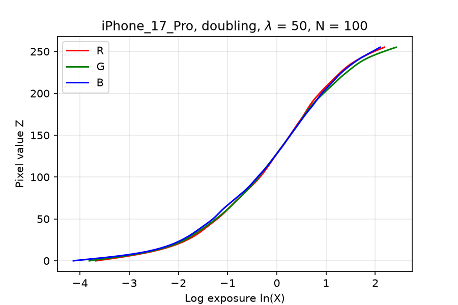 |

The behavior on $\lambda$ and $N$ experiments are similar with other cameras.

# Conclusion

The camera response recovery method proposed by Debevec and Malik implemented. I experimented the implementation on 10 different sequences provided and the sequence taken by my phone. As a result of experiment on sequences created by virtual camera, the response functions are recovered having a RMSE about 0.02. If noise comes, the RMSE increases. The effect of smoothness factor $\lambda$ and the sample pixel count $N$ is tested to see their effects. The response functions can be used to obtain radiance maps.
